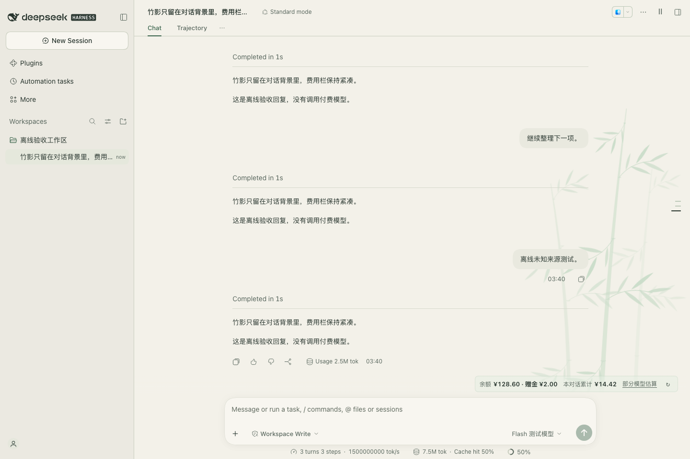

# 暖纸与雾绿 · DSH Workspace Skin

一个 DeepSeek Harness 原生插件：暖纸主题、淡绿色竹影，以及跟随模型扣费来源的余额与主对话费用展示。



## 功能

- 暖纸底色与绿色强调色，适配明暗主题，保留 DSH 原有布局。
- 竹竿、枝条、叶片分层运动：以 13 秒的缓风周期带动，小幅延迟响应，避免各自大幅摆动。支持暂停、后台暂停和系统减少动态效果。
- 半透明费用小卡片位于对话区右下、竹影底部。数字保持清晰，余额来源可悬停查看，也可展开估算说明查看。
- 余额跟随所选模型的 provider；登录账户的充值余额与赠金分开显示，不混合币种。
- 按完整会话日志、每次实际模型与用量估算主对话费用，切换模型不重算历史价格。
- 通用设置 → 暖纸与雾绿：控制主题、竹影和动画，也可恢复默认外观。

**当前版本：0.1.2。** 已验证 DSH **0.2.2-rc.1** 的原生 Web 运行时与 macOS 桌面应用。DSH 扩展接口仍可能变化；其他版本尚未验证。

## 安装

见 [安装与回退](INSTALL.md)。这是原生 JavaScript 插件，使用 React、CSS 与内嵌 SVG；无需 Skill，也不修改 DSH 应用包。

## 余额与费用范围

| 项目 | 行为 |
| --- | --- |
| DeepSeek 登录账户余额 | 调用 DSH 原生账号接口，无需向插件填写密钥 |
| API Key 和第三方来源余额 | 当前尚未接入；不会显示其他账号的余额代替 |
| 累计费用 | 仅主对话模型估算；不包含子任务、压缩、搜索、抓取 |
| 混合模型、重试 | 按每次实际路由与已记录用量统计，替换重复结算 |
| 缺失用量、未知模型或价格 | 显示部分估算或暂不可估，不当作零 |
| 峰谷价格 | 无法准确确定峰时或节假日时显示价格区间 |
| 价格有效期 | 2026-11-06 核查的快照，仅适用于北京时间 11 月 6 日至 12 月 5 日的调用 |

登录账户的模型费用也使用 API 人民币价格作参考，最终以实际账单为准。定价来源：[DeepSeek 模型与价格](https://api-docs.deepseek.com/zh-cn/quick_start/pricing/)。

## 开发与验证

需要 Node.js 22 或更新版本。

```sh
npm ci
npm run build
npm run check
```

原生端到端验收需要本机安装 DSH 0.2.2-rc.1、Python 3 与 Playwright Chromium：

```sh
npx playwright install chromium
npm run verify:native
```

验收提取本机应用运行时，在临时 DSH_HOME 中使用离线模型和虚构余额，不使用个人 profile 或产生模型费用。可通过 `PREVIEW_CHROMIUM` 指定已有 Chromium。运行时提取脚本目前支持 macOS 的默认应用路径。

证据：[界面验收](artifacts/e2e.json) · [费用回放](artifacts/host-replay.json) · [动画采样](artifacts/bamboo-motion.json) · [暗色截图](artifacts/native-dark.png)。所有仓库截图使用离线测试数据。

## 实现

- `src/host.js` / `src/cost.js`：原生 session projection 与费用统计。
- `src/client.cjs`：主题 token、原生 UI 插槽、账号查询与偏好。
- `src/bamboo.mjs`：构建时生成分层竹影 SVG。
- `src/skin.css`：配色、背景、动画与半透明费用卡片。
- `lib/client.js`：预编译 DSH lazy-CJS 客户端，图片和样式均内嵌。

偏好只在客户端 localStorage 保存三个布尔开关；不保存余额或密钥。停用会清理主题覆盖、装饰节点、监听器和插槽。修改价格规则需同步升级投影 `stateVersion`，避免历史缓存使用错误价格。

本主题旨在提供舒适、安静的阅读风格，不声称具有医学护眼疗效。
